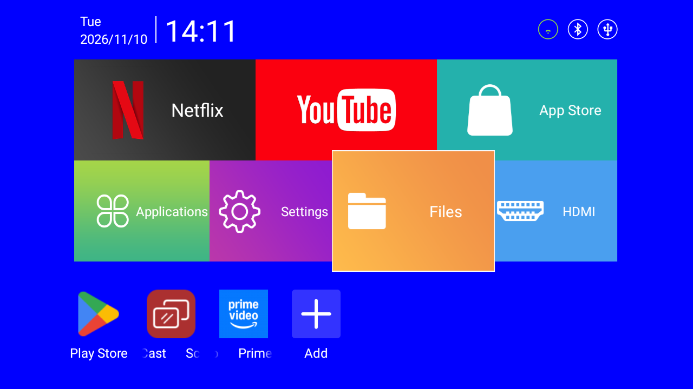
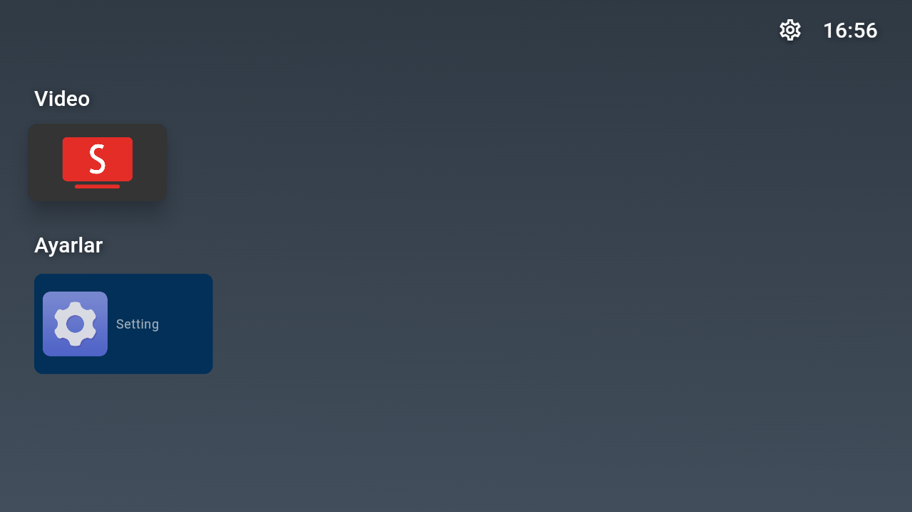

# projector

Debloat and control a MUTU HY320 Mini Android projector over Wi-Fi ADB. No root.

| Before | After |
| --- | --- |
|  |  |

## Device

| | |
| --- | --- |
| SoC | Allwinner H713 (`sun50iw12p1`) |
| RAM | ~1 GB |
| Screen | 1280x720 |
| Android | 11, not rooted, SELinux permissive |

Findings: [docs/findings.md](docs/findings.md)

## Setup

1. Install [adb](https://developer.android.com/tools/releases/platform-tools).
2. On the projector: enable developer options and network debugging.
3. Same Wi-Fi as your computer. Accept the prompt on first connect.

## Usage

```sh
export DEV=192.168.1.112:5555   # projector IP:port
export ADB=/path/to/adb         # if not in PATH

scripts/apply.sh --dry-run      # preview
scripts/apply.sh                # debloat (safe to re-run)
scripts/restore.sh              # undo everything
scripts/restore.sh <package>    # undo one package
scripts/snapshot.sh             # save device state (serial/MAC masked)
scripts/lamp.sh off|on|status   # lamp off, device stays online
```

Panel app (phone remote at `http://<projector-ip>:8080`):

```sh
cd panel && ./gradlew assembleDebug
../scripts/sign-panel.sh                 # platform key: live corners, no screen restart
adb install -r app-platform.apk
adb shell appops set local.projector.panel SYSTEM_ALERT_WINDOW allow
```

Open "Panel" once from the launcher. It also shows the current video and position, and can seek,
read from the device's media session. Needs the Android SDK (`sdk.dir` in `panel/local.properties`).
The sign script downloads the public AOSP platform key once, to `~/.local/android/platform-key`.
An unsigned build still works, but a 4-corner apply restarts the screen for ~25 seconds.

- Install [FLauncher](https://gitlab.com/flauncher/flauncher) first. Without it, the stock launcher stays.
- Wait ~30 s after changes before rebooting, or they are lost.

## Layout

```
config/     packages and settings to change
scripts/    apply, restore, snapshot, lamp, sign-panel
snapshots/  device dumps
panel/      Kotlin app: web remote on port 8080
docs/       findings, images
```
