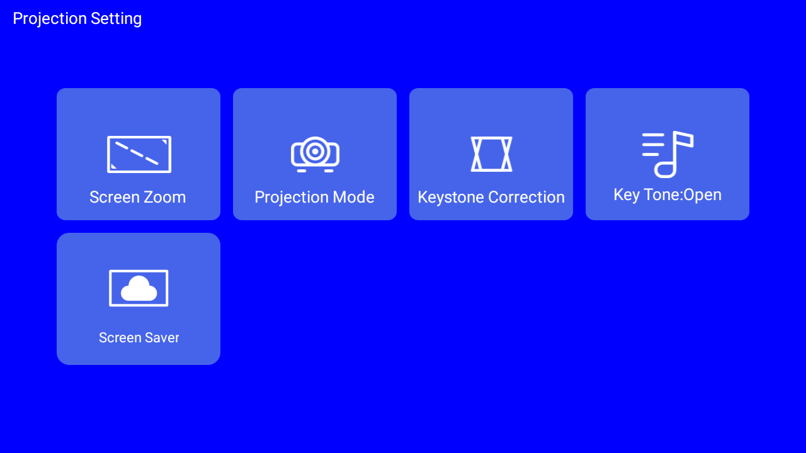

# Findings

All verified on the device, 2026-11-10.

## Security

- SELinux is permissive. Shell can `setprop` many `persist.*` values.
- The platform signature also grants `INJECT_EVENTS`, `REBOOT`, `DEVICE_POWER`,
  `READ_FRAME_BUFFER` and `ACCESS_SURFACE_FLINGER`, so the Panel can inject keys, reboot
  and take screenshots.
- The platform key is the public AOSP one (SHA-256 `c8:a2:e9:bc:...:2a:b8`), for
  `framework-res.apk`, HotackSettings and the other system apps. Any APK signed with
  `build/target/product/security/platform.pk8` gets signature permissions, e.g.
  `HARDWARE_TEST`. That is what makes the live 4-corner apply in the Panel app possible.
  It also means anyone can sign a system-privileged app for this device.
- ADB over network is on by default (port 5555). Connect still needs approval on screen.
- Security patch: 2022-02-05. Bootloader locked, `oem_unlock_supported=1`.
- Fingerprint claims to be Google ADT-3.
- `com.htc.*` apps are by Hotack, not HTC.
- Stock launcher contains an ad SDK (`com.zeasn.ad.connector`).
- `com.android.toofifi` runs as `com.huawei.connection`, with system uid, location and phone-state access.
- `com.htc.eventuploadservice` starts on boot and uploads events.

## Keystone

- Corners: `persist.display.keystone_{lb,lt,rt,rb}{x,y}`. Integers, divide by 1000.
- `setprop` works. SurfaceFlinger applies the values on boot (`mKeystoneTran` in logcat).
- Live apply is blocked for shell:
  - SurfaceFlinger transact `1050`: `Operation not permitted`
  - Broadcast `android.intent.hotack_keystone`: protected
- Original values: [snapshots/2026-11-10/before/keystone.txt](../snapshots/2026-11-10/before/keystone.txt)
- Settings screen: `am start -n com.htc.htcsettings/com.htc.activity.ProjectionActivity3`
- Live apply is done by system code only: `PhoneWindowManager.recognizesKeystone` and
  `com.htc.util.h` in HotackSettings read the props and call SurfaceFlinger `1050`.
  Triggers `com.htc.auto_keystone` and `android.intent.hotack_keystone` are protected broadcasts.
- SurfaceFlinger `1050` = token `android.ui.ISurfaceComposer` + 8 floats (lb, lt, rt, rb; x,y; value/1000).
  Needs `HARDWARE_TEST` (signature). Shell has `ACCESS_SURFACE_FLINGER` but that is not enough.
- Signing the Panel app with the AOSP platform key grants `HARDWARE_TEST`, so the app can
  call `1050` itself (`Corners.kt`, `scripts/sign-panel.sh`). Result: live 4 corners, no restart.
  The installed app reports `{"applied":true,"live":true}` and SurfaceFlinger logs the 8 floats.
- `screencap` shows the unwarped buffer, so a screenshot does not prove the corners were applied.
- `android.intent.projective_mode` is NOT protected. It runs `recognizesKeystone(angle)`:
  manual corners from `persist.sys.zoom.value` + auto tilt correction, then applies live.
  Only if `persist.sys.tpryauto=1` and |angle| < 45.
- Tilt sensor: `.../i2c-1/1-0018/input/input4/stk83xx/cur_angle`. Reads `-47` here (ceiling).
- The angle used is a cached value, not the sensor. With `tpryauto=0` the same broadcast loads it
  from `persist.sys.keystoneAngle`. So live keystone works (Panel app, `Keystone.kt`):
  1. `tpryauto=0`, `keystoneAngle=<tilt>`, send `projective_mode` (caches the angle)
  2. `zoom.value=<size x8>`, `tpryauto=1`, send `projective_mode` (applies)
- Result with zoom 0: tilt 0 = full screen. Tilt < 0 narrows the bottom edge, > 0 the top.
  Zoom adds an inset. Corners are not free: the system fits a symmetric trapezoid.
- SurfaceFlinger writes the applied corners back to `persist.display.keystone_*`.
- SurfaceFlinger reads `persist.display.keystone_*` only at boot (and gets corners via `1050`).
  No reload on `wm size`, `wm density`, `dumpsys`, or `persist.sys.keystone_vaf`.
- `setprop ctl.restart surfaceflinger` works from shell (SELinux permissive). It restarts SF and
  zygote (soft reboot, kernel keeps running). Panel back in ~23 s. Network ADB must reconnect.
- Auto keystone can override a manual tilt/scale. `persist.sys.keystoneAngle` is not a reliable
  indicator: it can hold the sensor angle (-47) even when a manual apply worked. Panel remembers
  the corners written back after its last manual apply and compares only those; a note appears
  when the current corners differ (auto keystone, preset or corner edit).
- Free 4 corners, two ways (Panel app, `Corners.kt`):
  - Platform-signed app (current): write the props, then call `1050` directly. Live.
  - Any other build: write the props and set `ctl.restart surfaceflinger` from the app uid.
    Works, but it is a ~23 s soft reboot and closes open apps.

## Lamp and fan

Use `scripts/lamp.sh`. Device stays online while the lamp is off.

- Lamp: `/sys/devices/platform/soc@2900000/5240000.ge2d/backlight/tv/bl_power`, mode `rw-rw-rw-`.
  - `5` = off, `6` = on. `0` does not turn it on.
- Lamp off also stops the fan.
- Fan is GPIO on/off (`fanctrl-gpio`), no speed control. Always full speed while the lamp is on.
  `PrjScreen.set_fan_level` (`persist.sys.prj.fanlevel`, `2009800.fan/pwm_fan`) is for other models;
  that path does not exist here.
- `debug_fantrl` is a wrapping pulse counter, not a speed. Lamp on: steady ~118 per 0.5 s.
- `fan_ctrl` uses one pin, PH17 (gpio-241), as an input: the tach. No output pin. Fan power comes
  with the lamp, so software cannot slow it.
- Device tree has a `pwm-fan` node (`2009800.fan`, 8 speed levels) but `status: disabled`.
  Enabling it needs a new DT, i.e. an unlocked bootloader. Its `fan2-run-gpio` (PH14) is the focus
  `limiter-gpio` here, so this board is likely not wired for it.
- `fan_ctrl/usba_sw` (gpio-33) is not the fan. It routes the USB-A port (system vs HDMI dongle).
- Fan guard (`PhoneWindowManager`, `services.jar`):
  - Every 1.8 s it reads `/sys/devices/platform/fan_ctrl/debug_fantrl`.
  - Slow fan + `sys.start_fan_fun=1` + `sys.shutdown_backlight!=1` → counter +1.
  - Counter > 3 → `android.htc.fanctrl` → `com.htc.closedialog` shuts the device down.
  - The counter never resets until it fires.
- Safe order:
  - Off: `sys.shutdown_backlight=1`, `sys.start_fan_fun=0`, then `bl_power=5`.
  - On: `bl_power=6`, wait ~12 s, then `sys.start_fan_fun=1`, `sys.shutdown_backlight=0`.
- Other hardware (from `android.os.PrjScreen` in `framework.jar`): focus motor `/sys/devices/platform/motor_ctr/`,
  angle sensor `.../4-001b/sensor_angle`, auto keystone `persist.sys.tpryxcrt`, auto focus `persist.sys.vafocus`.

## Focus

- Motor: `/sys/devices/platform/motor_ctr/motor_ctrl`, mode 666, so apps can write it.
- Remote focus keys (`PhoneWindowManager`): up = write `257`, then `386` every 70 ms while held.
  Down = `513`, then `642`.
- Read: first char `1` = up end reached, second char `1` = down end reached (e.g. `00.400.01`).
- Middle field is the position (400 at start). One step is about 1-2 units.
  The value updates ~100 ms after a step.
- One-step manual nudge is back in the Panel (`Focus.kt`); auto focus is on (`persist.sys.vafocus=1`).

## Power

- Sleep (`KEYCODE_SLEEP`) drops Wi-Fi. No wake over network.
- Power key opens a 15 s shutdown countdown. Menu key opens OEM settings.
- Panel has reboot/shutdown (`PowerManager`, signature permissions) and a panel-service restart.
  Shutdown needs the physical power button to come back.

## Panel app

App in `panel/`, runs as a normal (non-system) app.

- Works without extra rights: media keys (`AudioManager.dispatchMediaKeyEvent`), volume.
- Opening another app from a service is blocked on Android 11 ("Background activity start").
  Fix: declare `SYSTEM_ALERT_WINDOW` in the manifest and run
  `appops set local.projector.panel SYSTEM_ALERT_WINDOW allow`. Both are needed.
- SmartTube opens YouTube links with `ACTION_VIEW` + package `org.smarttube.stable`.
- Starts on boot (`BOOT_COMPLETED`), verified.
- Lamp works from the app (`Lamp.kt`), same order as `lamp.sh`. App uid can write `bl_power`
  (mode 666) and run `setprop sys.*`; SELinux logs denials but allows them (permissive).
  Checks the fan guard props before cutting the lamp.
- Keystone screen opens with `setClassName("com.htc.htcsettings", "com.htc.activity.ProjectionActivity3")`.
- D-pad/back/home/menu: `Instrumentation().sendKeyDownUpSync(code)` works from the app uid with
  `INJECT_EVENTS`. The panel exposes only those eight keys.
- Power: `PowerManager.reboot`, hidden `shutdown`, and stopping/starting `PanelService` for a
  quick panel restart.
- Auto switches: `persist.sys.tpryxcrt` (auto keystone) and `persist.sys.vafocus` (auto focus).
  `tpryxcrt=0` does not stop `persist.sys.keystoneAngle` from showing the sensor angle; a real
  tilt test is still needed to confirm the correction stops.
- Focus nudge: one press writes 257 (up) or 513 (down), then 386/642 after 70 ms. One step moves
  the position by ~1-3 units.
- LEDs: `/sys/class/leds/{pwr-r,status-g,led3-b}/brightness` are world-writable; 0/1 works.
- Preview: `screencap` exits 1 from the app process (even with the permission). The hidden
  `SurfaceControl.screenshot(Rect, 1280, 720, false, displayId)` via reflection works with
  `READ_FRAME_BUFFER` + `ACCESS_SURFACE_FLINGER`; the result is a 1280x720 hardware bitmap,
  copied to ARGB_8888 and compressed to PNG. It does not include the keystone warp.
- Brightness/colour: vendor HIDL `vendor.aw.homlet.tvsystem.tvserver@1.0::ITvServer`, reached
  through `HwBinder` reflection. Transact 98 reads, 97 writes. Type 1 = brightness (0..100),
  type 12 = colour temperature (0..2). This is the path the OEM brightness screen uses.
- Preset export/import/rename and the PWA install button are app-side only.

### Type, apps, links and local video (expected, device test pending)

- Typing uses `Instrumentation.sendStringSync` for text and `sendKeyDownUpSync` for
  enter/backspace/clear. Limited to 200 characters; needs `INJECT_EVENTS`.
- Apps: `getInstalledApplications` plus launch intents, with `QUERY_ALL_PACKAGES` for Android 11
  package visibility.
- Links: host map for YouTube, Kick, Prime, TV+, Twitch, Netflix and Disney+. Exact package names
  are tried first, then a package-name keyword. A known app that rejects a web URL falls back to
  its main screen.
- Upload is a raw `POST /api/upload?name=...` with `Content-Length`; the body is streamed to
  MediaStore, not buffered in memory.
- Files go to `Movies/Panel` as app-owned media. No storage permission is needed for files the
  app created itself. Limits: 500 MB per file, 2 GB total, 50 MB free-space margin.
- A failed or short upload deletes the pending row.
- Playback sends the content URI to VLC (`org.videolan.vlc`) with
  `FLAG_GRANT_READ_URI_PERMISSION`. Without VLC it falls back to any player that accepts the URI.

## Now playing

- `dumpsys media_session` lists the sessions. SmartTube publishes playback state
  (position, speed), `DURATION` and `MEDIA_ID` (the YouTube video id). `TITLE` and `ARTIST`
  are present but null.
- Panel app (`NowPlaying.kt`) reads them with `MediaSessionManager.getActiveSessions(null)`.
  Needs `MEDIA_CONTENT_CONTROL` (signature|privileged), granted by the platform signature.
- Title and channel come from YouTube's public oEmbed endpoint, cached per video.
  Position is advanced with `PlaybackState` speed from the last update time.
- Only apps with a media session show up (SmartTube, VLC, ...). HDMI input and apps without
  a session do not.

## Presets, status, PWA

- Corner presets and the factory reset live in the app (`Corners.kt`, SharedPreferences).
  Factory values are the first snapshot: `ltx lty rtx rty` = 166 165 165 165,
  `lbx lby rbx rby` = 222 287 222 287.
- Status (`SystemStatus.kt`): `thermal_zone0/1` (CPU/GPU, millidegrees), `/proc/meminfo`,
  `StatFs`, Wi-Fi RSSI + local IP, `persist.sys.keystoneAngle`, lamp and fan guard props,
  and the top activity via `ActivityManager.getRunningTasks` (`REAL_GET_TASKS`, signature).
- `android.os.PrjScreen` is a stub on this build: `set_bright`/`get_bright` only log and return 0,
  and the temperature getters read `/sys/devices/platform/2009800.fan/...`, which does not exist.
  Do not use it for brightness or temperatures.
- Brightness and color temperature are handled by `com.softwinner.a` (DisplayPQ) inside the OEM
  settings app (`BrightnessActivity`, `ColorTemperatureActivity`). Not exposed to normal apps.
- PWA: manifest, icons, service worker and `/share` are served. Install and share target need
  HTTPS with a certificate the phone trusts; see below.

## HTTPS and PWA

- The Panel serves HTTPS on `8443` with a server certificate from a local CA
  (`scripts/make-cert.sh`). The SAN contains the projector IP.
- The CA private key stays in `~/.local/android/projector-cert`; the app assets hold the server
  key/cert and the public CA. On a new machine or after an IP change, rerun the script. The CA
  itself stays the same, so the phone does not need to install a new one.
- On Android, install `ca.crt` as a CA certificate (Settings -> Security -> Encryption &
  credentials -> Install a certificate; a screen lock is required), then open
  `https://<ip>:8443/`. Chrome can install the PWA, and the share target sends links to
  `/share`, which calls the `open` action.
- A service worker only registers with a trusted certificate. Chrome still refuses it when the
  page is opened through a certificate error (`--ignore-certificate-errors` or Playwright's
  `ignoreHTTPSErrors`), even though `isSecureContext` is true. The CA must be installed.
- `/server.key.der` is blocked by the web server, but it is still inside the APK: treat it as a
  local key. The CA key is in neither the APK nor the repo.

## Sleep timer

- Panel app (`SleepTimer.kt`): at the end it sends media pause, then `Lamp.off()`.
- End time is saved, so it survives an app restart. Missed by more than 10 min: dropped.
- A toast shows on the projector 1 min before. Text toasts from a background app work here.

## Performance

| Change | Result |
| --- | --- |
| Remove apps | Data used: 1.4 GB → 835 MB |
| Stock launcher → FLauncher | Free RAM: 398 → 480 MB |
| Google services off | No measurable gain |
| 15 more apps off | Used RAM: 689 → 669 MB |

- FLauncher uses ~93 MB.
- App freezer: not supported by the kernel.
- Shell cannot disable a single app component.

## Gotchas

- Wait ~30 s after `pm uninstall` / `disable-user` before rebooting.
- `adb shell` eats stdin inside `while read`. Use `</dev/null`.
- `pm clear me.efesser.flauncher` also resets the default home. Re-run `apply.sh`.
- SmartTube: use only official GitHub builds 30.56+ (signing key leaked in Nov 2025).
